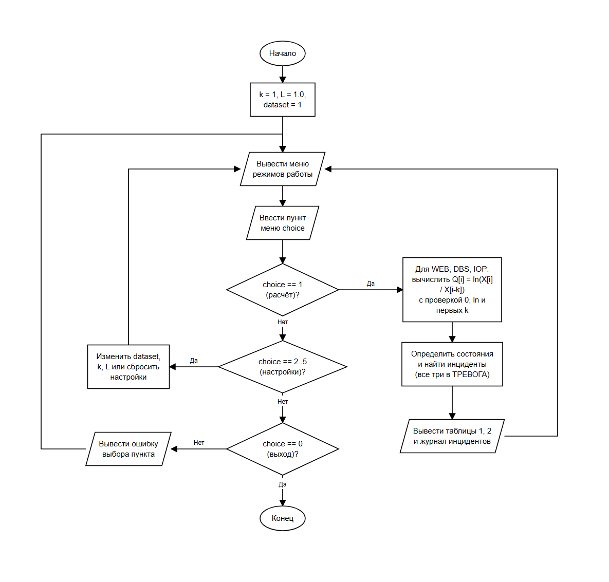

# Курсовой проект «Реализация программы контроля облачной инфраструктуры»

## 1. Назначение программы

Программа на языке C предназначена для контроля состояния облачной инфраструктуры по последовательности телеметрических измерений. Программа:

- хранит наборы телеметрических измерений по трём компонентам в одномерных массивах (без использования двумерных массивов);
- вычисляет производный показатель динамики $Q[i]$ для произвольного периода сравнения $k$;
- обрабатывает пропуск первых $k$ элементов, деление на ноль и недопустимый аргумент логарифма;
- определяет состояние каждого компонента по порогу $L$;
- проверяет правило инцидента и формирует журнал инцидентов;
- предоставляет текстовое меню для выбора набора данных и настройки параметров анализа.

## 2. Индивидуальный вариант (вариант 25)

| Параметр | Значение |
|---|---|
| Компоненты | WEB, DBS, IOP |
| Порядок записи | А: время, компонент, значение |
| Разделитель | запятая |
| Тип последовательности | 4: произвольный порядок, возможны пропуски измерений |
| Производный показатель | логарифм отношения |
| Период сравнения $k$ (по умолчанию) | 1 (настраивается от 1 до 4) |
| Порог $L$ (по умолчанию) | 1.0 (настраивается положительным числом) |
| Параметр $D$ | 10 |
| Правило состояния | выход за диапазон $[L_{\min}, L_{\max}]$ |
| Правило инцидента | все три компонента одновременно в состоянии, отличном от «НОРМА» |
| Структура `Incident` | `int time; int type;` |

Инфраструктурные компоненты:

- **WEB** — веб-сервер, обслуживающий внешние запросы;
- **DBS** — сервер базы данных;
- **IOP** — подсистема ввода-вывода.

## 3. Математическая модель

### 3.1. Производный показатель

Для каждого компонента вычисляется логарифм отношения текущего значения к значению, отстоящему на $k$ измерений назад:

$$
Q[i] = \ln\left(\frac{X[i]}{X[i-k]}\right).
$$

Если $i < k$, пара для сравнения отсутствует и измерение пропускается. При $|X[i-k]| < 10^{-9}$ фиксируется ошибка деления на ноль, а при $X[i] / X[i-k] \le 0$ — ошибка недопустимого аргумента логарифма.

### 3.2. Правило состояния компонента

При $L_{\min} = -L$ и $L_{\max} = L$ состояние компонента определяется так:

$$
S_i =
\begin{cases}
1, & Q[i] < L_{\min} \ \lor \ Q[i] > L_{\max},\\
0, & L_{\min} \le Q[i] \le L_{\max},
\end{cases}
$$

где $1$ соответствует состоянию «ТРЕВОГА», $0$ — состоянию «НОРМА».

### 3.3. Правило инцидента

Инцидент фиксируется, когда все три компонента на одном отсчёте находятся в состоянии «ТРЕВОГА»:

$$
I(t) = A_{\text{WEB}}(t) \land A_{\text{DBS}}(t) \land A_{\text{IOP}}(t),
$$

$$
A_c(t) = \left(Q_c(t) < L_{\min}\right) \lor \left(Q_c(t) > L_{\max}\right).
$$

## 4. Организация данных и структура программы

### 4.1. Формат исходных данных

Контрольный набор варианта 25 в исходном представлении:

```text
4,WEB,48.8, 2,DBS,55.4, 2,IOP,29.5, 5,DBS,54.8, 3,WEB,48.3, 5,WEB,49.3, 5,IOP,32.6, 4,DBS,51.4, 1,IOP,30.2, 1,DBS,57.4, 3,IOP,34.1, 1,WEB,41.9, 3,DBS,53.4
```

Всего 13 записей по 5 отсчётам (у `WEB` пропущен отсчёт 2, у `IOP` — отсчёт 4):

| Компонент | t = 1 | t = 2 | t = 3 | t = 4 | t = 5 |
|---|---:|---:|---:|---:|---:|
| WEB | 41.9 | нет данных | 48.3 | 48.8 | 49.3 |
| DBS | 57.4 | 55.4 | 53.4 | 51.4 | 54.8 |
| IOP | 30.2 | 29.5 | 34.1 | нет данных | 32.6 |

### 4.2. Структуры данных

Для хранения записей журнала инцидентов и рядов компонентов используются структуры с одномерными массивами:

```c
typedef struct {
	int time;               /* номер отсчёта */
	int type;               /* тип инцидента */
} Incident;

typedef struct {
	char name[NAME_LEN];        /* код компонента */
	float values[MAX_MEASURE];  /* измеренные значения */
	int times[MAX_MEASURE];     /* номера отсчётов */
	int count;                  /* число измерений */
	double q_vals[POINT_COUNT]; /* значения показателя Q */
	int codes[POINT_COUNT];     /* коды результата расчёта */
	int states[POINT_COUNT];    /* состояния по отсчётам */
} Component;
```

### 4.3. Функции программы

Программа в `main.c` разделена на функции:

- `calc_q` — вычисляет $Q = \ln(X[i] / X[i-k])$, проверяет деление на ноль и знак отношения; возвращает код результата (`CALC_OK`, `CALC_DIV_ZERO`, `CALC_BAD_LOG`) и записывает значение по указателю `*pq`;
- `check_component` — обрабатывает измерения одного компонента при заданных `k` и `limit`, заполняет массивы `q_vals`, `codes`, `states` и возвращает число успешно рассчитанных `Q`;
- `is_incident` — реализует логическое правило одновременной тревоги трёх компонентов;
- `find_incidents` — сканирует отсчёты и заполняет журнал `Incident incidents[]`;
- `print_component_rows` и `print_results` — выводят таблицу расчёта `Q`, таблицу состояний по отсчётам и журнал инцидентов;
- `run_analysis` — подготавливает выбранный набор данных (1 — контрольный набор варианта 25; 2 — тестовый набор с ошибками и инцидентом) и запускает анализ;
- `state_name` — возвращает текстовое название состояния;
- `read_int_range` и `read_positive_double` — выполняют безопасный ввод пунктов меню и параметров `k`, `L`.

## 5. Алгоритм и блок-схема

1. **Начало**.
2. Задать параметры по умолчанию: $k = 1$, $L = 1.0$, набор данных `1`.
3. Вывести меню режимов работы и считать выбор пользователя `choice`.
4. При `choice == 1`: рассчитать `Q[i]` по парам $X[i]$ и $X[i-k]$ для `WEB`, `DBS`, `IOP` с пропуском первых $k$ элементов и проверкой ошибок, определить состояния, найти инциденты и вывести результаты.
5. При `choice == 2..5`: сменить набор данных, задать $k$, задать $L$ или сбросить настройки.
6. При `choice == 0`: завершить работу; при неверном вводе вывести сообщение об ошибке и повторить меню.
7. **Конец**.



## 6. Сборка и запуск

В CLion: открыть проект `KP`, выбрать конфигурацию `KP` и нажать Run.

Из командной строки:

```text
cmake -S . -B build
cmake --build build
build/KP.exe
```

## 7. Контрольные примеры и проверка работы

### 7.1. Основной контрольный пример (набор 1, k = 1, L = 1.0)

Примеры ручной подстановки в формулу:

$$
Q_{\text{WEB}}(3) = \ln\left(\frac{48.3}{41.9}\right) = \ln(1.152745) = 0.1421,
$$

$$
Q_{\text{DBS}}(4) = \ln\left(\frac{51.4}{53.4}\right) = \ln(0.962547) = -0.0382,
$$

$$
Q_{\text{IOP}}(3) = \ln\left(\frac{34.1}{29.5}\right) = \ln(1.155932) = 0.1449.
$$

Сравнение ручного расчёта и результатов программы (`10` пар):

| Компонент | Время i | X[i] | Время i-k | X[i-k] | Q вручную | Q программы | Состояние | Совпадение |
|---|---:|---:|---:|---:|---:|---:|---|---|
| WEB | 3 | 48.3 | 1 | 41.9 | 0.1421 | 0.1421 | НОРМА | да |
| WEB | 4 | 48.8 | 3 | 48.3 | 0.0103 | 0.0103 | НОРМА | да |
| WEB | 5 | 49.3 | 4 | 48.8 | 0.0102 | 0.0102 | НОРМА | да |
| DBS | 2 | 55.4 | 1 | 57.4 | -0.0355 | -0.0355 | НОРМА | да |
| DBS | 3 | 53.4 | 2 | 55.4 | -0.0368 | -0.0368 | НОРМА | да |
| DBS | 4 | 51.4 | 3 | 53.4 | -0.0382 | -0.0382 | НОРМА | да |
| DBS | 5 | 54.8 | 4 | 51.4 | 0.0641 | 0.0641 | НОРМА | да |
| IOP | 2 | 29.5 | 1 | 30.2 | -0.0235 | -0.0235 | НОРМА | да |
| IOP | 3 | 34.1 | 2 | 29.5 | 0.1449 | 0.1449 | НОРМА | да |
| IOP | 5 | 32.6 | 3 | 34.1 | -0.0450 | -0.0450 | НОРМА | да |

Все полученные значения лежат в диапазоне $[-1.0; 1.0]$, поэтому состояния всех доступных отсчётов — «НОРМА», инцидентов нет.

Вывод программы при `k = 1`, `L = 1.0`:

```text
Программа контроля облачной инфраструктуры
Назначение: расчёт показателя Q и выявление инцидентов
Вариант 25: компоненты WEB, DBS, IOP, Q[i] = ln(X[i] / X[i-k])

Режим: набор 1 (вариант 25), k = 1, L = 1.00
1 - Выполнить расчёт
2 - Выбрать набор данных (1 - вариант 25, 2 - тест ошибок)
3 - Задать период сравнения k
4 - Задать порог нормы L
5 - Сбросить настройки по умолчанию
0 - Выход
Выберите действие: 1

Параметры: k = 1, L = 1.00, норма: [-1.00; 1.00]

Таблица 1. Расчёт показателя Q по измерениям
Компонент Время i X[i]  Время i-k X[i-k] Q        Состояние
WEB       1       41.9  -         -      нет Q    пропуск (первые k)
WEB       3       48.3  1         41.9   0.1421   НОРМА
WEB       4       48.8  3         48.3   0.0103   НОРМА
WEB       5       49.3  4         48.8   0.0102   НОРМА
DBS       1       57.4  -         -      нет Q    пропуск (первые k)
DBS       2       55.4  1         57.4   -0.0355  НОРМА
DBS       3       53.4  2         55.4   -0.0368  НОРМА
DBS       4       51.4  3         53.4   -0.0382  НОРМА
DBS       5       54.8  4         51.4   0.0641   НОРМА
IOP       1       30.2  -         -      нет Q    пропуск (первые k)
IOP       2       29.5  1         30.2   -0.0235  НОРМА
IOP       3       34.1  2         29.5   0.1449   НОРМА
IOP       5       32.6  3         34.1   -0.0450  НОРМА

Таблица 2. Состояния компонентов по отсчётам
Время	WEB	DBS	IOP	Инцидент
1	нет Q	нет Q	нет Q	нет
2	нет Q	НОРМА	НОРМА	нет
3	НОРМА	НОРМА	НОРМА	нет
4	НОРМА	НОРМА	нет Q	нет
5	НОРМА	НОРМА	НОРМА	нет

Журнал инцидентов:
Инцидентов не обнаружено.

Рассчитано значений Q: 10, ошибок вычислений: 0
```

### 7.2. Проверка при другом периоде сравнения (набор 1, k = 2, L = 1.0)

При $k = 2$ первые два измерения каждого компонента пропускаются, рассчитывается `7` пар:

| Компонент | Время i | X[i] | Время i-k | X[i-k] | Q вручную | Q программы | Состояние |
|---|---:|---:|---:|---:|---:|---:|---|
| WEB | 4 | 48.8 | 1 | 41.9 | 0.1524 | 0.1524 | НОРМА |
| WEB | 5 | 49.3 | 3 | 48.3 | 0.0205 | 0.0205 | НОРМА |
| DBS | 3 | 53.4 | 1 | 57.4 | -0.0722 | -0.0722 | НОРМА |
| DBS | 4 | 51.4 | 2 | 55.4 | -0.0749 | -0.0749 | НОРМА |
| DBS | 5 | 54.8 | 3 | 53.4 | 0.0259 | 0.0259 | НОРМА |
| IOP | 3 | 34.1 | 1 | 30.2 | 0.1215 | 0.1215 | НОРМА |
| IOP | 5 | 32.6 | 2 | 29.5 | 0.0999 | 0.0999 | НОРМА |

Вывод программы при `k = 2`:

```text
Параметры: k = 2, L = 1.00, норма: [-1.00; 1.00]

Таблица 1. Расчёт показателя Q по измерениям
Компонент Время i X[i]  Время i-k X[i-k] Q        Состояние
WEB       1       41.9  -         -      нет Q    пропуск (первые k)
WEB       3       48.3  -         -      нет Q    пропуск (первые k)
WEB       4       48.8  1         41.9   0.1524   НОРМА
WEB       5       49.3  3         48.3   0.0205   НОРМА
DBS       1       57.4  -         -      нет Q    пропуск (первые k)
DBS       2       55.4  -         -      нет Q    пропуск (первые k)
DBS       3       53.4  1         57.4   -0.0722  НОРМА
DBS       4       51.4  2         55.4   -0.0749  НОРМА
DBS       5       54.8  3         53.4   0.0259   НОРМА
IOP       1       30.2  -         -      нет Q    пропуск (первые k)
IOP       2       29.5  -         -      нет Q    пропуск (первые k)
IOP       3       34.1  1         30.2   0.1215   НОРМА
IOP       5       32.6  2         29.5   0.0999   НОРМА

Таблица 2. Состояния компонентов по отсчётам
Время	WEB	DBS	IOP	Инцидент
1	нет Q	нет Q	нет Q	нет
2	нет Q	нет Q	нет Q	нет
3	нет Q	НОРМА	НОРМА	нет
4	НОРМА	НОРМА	нет Q	нет
5	НОРМА	НОРМА	НОРМА	нет

Журнал инцидентов:
Инцидентов не обнаружено.

Рассчитано значений Q: 7, ошибок вычислений: 0
```

При `k = 4` у `WEB` и `IOP` рассчитывается `0` пар (все значения пропускаются), а у `DBS` рассчитывается `1` пара (`t = 5` и `t = 1`, $Q = -0.0464$, `НОРМА`).

### 7.3. Проверка обработки ошибок и инцидента (набор 2, k = 1, L = 1.0)

Тестовый набор 2:

- `WEB`: `10.0, 30.0, 0.0, 15.0, -5.0` (отсчёты `1..5`);
- `DBS`: `40.0, 10.0, 12.0, 12.5, 0.0` (отсчёты `1..5`);
- `IOP`: `5.0, 20.0, 21.0, 19.0, 18.0` (отсчёты `1..5`).

Ручная проверка:

- на $t = 2$: $Q_{\text{WEB}} = \ln(30 / 10) = 1.0986 > 1.0$ (`ТРЕВОГА`), $Q_{\text{DBS}} = \ln(10 / 40) = -1.3863 < -1.0$ (`ТРЕВОГА`), $Q_{\text{IOP}} = \ln(20 / 5) = 1.3863 > 1.0$ (`ТРЕВОГА`) — фиксируется инцидент (`Время 2, тип 1`);
- на $t = 3$ у `WEB`: $X[i] = 0$ — ошибка `аргумент ln <= 0`;
- на $t = 4$ у `WEB`: $X[i-1] = 0$ — ошибка `деление на 0`;
- на $t = 5$ у `WEB` ($X[i] = -5$) и `DBS` ($X[i] = 0$) — ошибка `аргумент ln <= 0`.

Вывод программы для набора 2:

```text
Параметры: k = 1, L = 1.00, норма: [-1.00; 1.00]

Таблица 1. Расчёт показателя Q по измерениям
Компонент Время i X[i]  Время i-k X[i-k] Q        Состояние
WEB       1       10.0  -         -      нет Q    пропуск (первые k)
WEB       2       30.0  1         10.0   1.0986   ТРЕВОГА
WEB       3       0.0   2         30.0   ОШИБКА   аргумент ln <= 0
WEB       4       15.0  3         0.0    ОШИБКА   деление на 0
WEB       5       -5.0  4         15.0   ОШИБКА   аргумент ln <= 0
DBS       1       40.0  -         -      нет Q    пропуск (первые k)
DBS       2       10.0  1         40.0   -1.3863  ТРЕВОГА
DBS       3       12.0  2         10.0   0.1823   НОРМА
DBS       4       12.5  3         12.0   0.0408   НОРМА
DBS       5       0.0   4         12.5   ОШИБКА   аргумент ln <= 0
IOP       1       5.0   -         -      нет Q    пропуск (первые k)
IOP       2       20.0  1         5.0    1.3863   ТРЕВОГА
IOP       3       21.0  2         20.0   0.0488   НОРМА
IOP       4       19.0  3         21.0   -0.1001  НОРМА
IOP       5       18.0  4         19.0   -0.0541  НОРМА

Таблица 2. Состояния компонентов по отсчётам
Время	WEB	DBS	IOP	Инцидент
1	нет Q	нет Q	нет Q	нет
2	ТРЕВОГА	ТРЕВОГА	ТРЕВОГА	ДА
3	ОШИБКА	НОРМА	НОРМА	нет
4	ОШИБКА	НОРМА	НОРМА	нет
5	ОШИБКА	ОШИБКА	НОРМА	нет

Журнал инцидентов:
Время 2, тип 1

Рассчитано значений Q: 8, ошибок вычислений: 4
```

Скриншот запуска тестового примера в CLion:

`<!-- Вставить скриншот после запуска в CLion, например:  -->`

## 8. Разработчик

Сбоев Даниил Игоревич, группа бОТИ-261.
