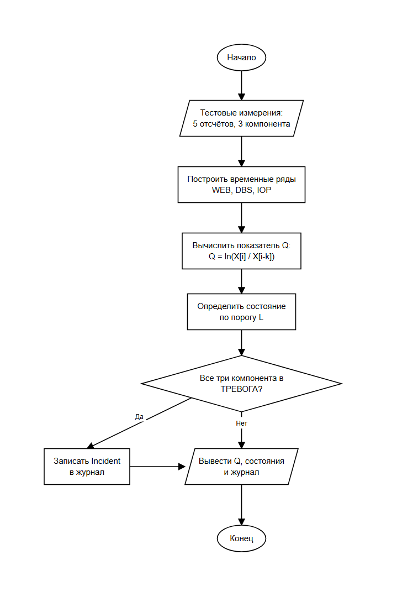

# Курсовой проект «Реализация программы контроля облачной инфраструктуры»

## Вариант 25. Этап 1 (КТ1): контрольный расчёт на пяти отсчётах

### 1. Назначение программы

Программа на языке C предназначена для контроля облачной инфраструктуры по последовательности телеметрических измерений. На первом этапе программа:

- хранит тестовый набор из пяти отсчётов по трём компонентам;
- формирует временные ряды компонентов;
- вычисляет производный показатель динамики Q;
- определяет состояние каждого компонента;
- проверяет правило инцидента и формирует журнал инцидентов.

### 2. Индивидуальный вариант

| Параметр | Значение |
|---|---|
| Компоненты | WEB, DBS, IOP |
| Порядок записи | А: время, компонент, значение |
| Разделитель | запятая |
| Тип последовательности | 4: произвольный порядок, возможны пропуски измерений |
| Производный показатель | логарифм отношения |
| Период сравнения k | 1 |
| Порог L | 1.0 |
| Параметр D | 10 |
| Правило состояния | выход за диапазон [Lmin, Lmax] |
| Правило инцидента | все три компонента одновременно в состоянии, отличном от «НОРМА» |
| Структура Incident | `int time; int type;` |

#### 2.1. Производный показатель

Для каждого компонента вычисляется логарифм отношения текущего значения к значению на k отсчётов раньше:

$$
Q[i] = \ln\left(\frac{X[i]}{X[i-k]}\right), \qquad k = 1.
$$

#### 2.2. Правило состояния компонента

Состояние компонента:

$$
S_i =
\begin{cases}
1, & Q[i] < L_{\min} \ \lor \ Q[i] > L_{\max},\\
0, & L_{\min} \le Q[i] \le L_{\max},
\end{cases}
$$

где 1 соответствует состоянию «ТРЕВОГА», 0 соответствует состоянию «НОРМА».

#### 2.3. Правило инцидента

Инцидент фиксируется только тогда, когда все три компонента одновременно находятся в состоянии, отличном от «НОРМА». Логическое выражение:

$$
I(t) = A_{\text{WEB}}(t) \land A_{\text{DBS}}(t) \land A_{\text{IOP}}(t),
$$

$$
A_c(t) = \left(Q_c(t) < L_{\min}\right) \lor \left(Q_c(t) > L_{\max}\right).
$$

#### 2.4. Структура Incident

```c
typedef struct {
    int time;
    int type;
} Incident;
```

Поля структуры:

- `time` - номер отсчёта, на котором зафиксирован инцидент;
- `type` - тип инцидента.

### 3. Инфраструктурные компоненты

- **WEB** - веб-сервер, обслуживающий внешние запросы.
- **DBS** - сервер базы данных.
- **IOP** - подсистема ввода-вывода.

### 4. Формат исходных данных


```text
4,WEB,48.8, 2,DBS,55.4, 2,IOP,29.5, 5,DBS,54.8, 3,WEB,48.3, 5,WEB,49.3, 5,IOP,32.6, 4,DBS,51.4, 1,IOP,30.2, 1,DBS,57.4, 3,IOP,34.1, 1,WEB,41.9, 3,DBS,53.4
```

Всего 13 записей.

Получается таблица:

| Компонент | t = 1 | t = 2 | t = 3 | t = 4 | t = 5 |
|---|---:|---:|---:|---:|---:|
| WEB | 41.9 | нет данных | 48.3 | 48.8 | 49.3 |
| DBS | 57.4 | 55.4 | 53.4 | 51.4 | 54.8 |
| IOP | 30.2 | 29.5 | 34.1 | нет данных | 32.6 |

### 5. Контрольный пример

| Компонент | Время i | X[i] | Время i-k | X[i-k] | X[i] / X[i-k] | Q | Состояние |
|---|---:|---:|---:|---:|---:|---:|---|
| WEB | 3 | 48.3 | 1 | 41.9 | 1.152745 | 0.1421 | НОРМА |
| WEB | 4 | 48.8 | 3 | 48.3 | 1.010352 | 0.0103 | НОРМА |
| WEB | 5 | 49.3 | 4 | 48.8 | 1.010246 | 0.0102 | НОРМА |
| DBS | 2 | 55.4 | 1 | 57.4 | 0.965157 | -0.0355 | НОРМА |
| DBS | 3 | 53.4 | 2 | 55.4 | 0.963899 | -0.0368 | НОРМА |
| DBS | 4 | 51.4 | 3 | 53.4 | 0.962547 | -0.0382 | НОРМА |
| DBS | 5 | 54.8 | 4 | 51.4 | 1.066148 | 0.0641 | НОРМА |
| IOP | 2 | 29.5 | 1 | 30.2 | 0.976821 | -0.0235 | НОРМА |
| IOP | 3 | 34.1 | 2 | 29.5 | 1.155932 | 0.1449 | НОРМА |
| IOP | 5 | 32.6 | 3 | 34.1 | 0.956012 | -0.0450 | НОРМА |

Примеры подстановки в формулу:

$$
Q_{\text{WEB}}(3) = \ln\left(\frac{48.3}{41.9}\right) = \ln(1.152745) = 0.1421,
$$

$$
Q_{\text{DBS}}(4) = \ln\left(\frac{51.4}{53.4}\right) = \ln(0.962547) = -0.0382,
$$

$$
Q_{\text{IOP}}(3) = \ln\left(\frac{34.1}{29.5}\right) = \ln(1.155932) = 0.1449.
$$

Все полученные значения удовлетворяют условию $-1.0 \le Q \le 1.0$, поэтому все компоненты во всех доступных отсчётах находятся в состоянии «НОРМА».

### 6. Результаты работы программы

Сборка и запуск в CLion: открыть проект `KP`, выбрать конфигурацию `KP` и нажать Run.

Сборка из командной строки:

```text
cmake -S . -B build
cmake --build build
build/KP.exe
```

Вывод программы:

```text
Курсовой проект: контроль облачной инфраструктуры
Вариант 25, этап 1: контрольный расчёт на пяти отсчётах
Компоненты: WEB, DBS, IOP
Q[i] = ln(X[i] / X[i-k]), k = 1, L = 1.0
Диапазон нормы: [-1.0; 1.0]
Тестовый набор: 13 измерений, 5 отсчётов

Таблица 1. Расчёт показателя Q по доступным парам измерений
Компонент	Время i	X[i]	Время i-k	X[i-k]	Q	Состояние
WEB	3	48.3	1	41.9	0.1421	НОРМА
WEB	4	48.8	3	48.3	0.0103	НОРМА
WEB	5	49.3	4	48.8	0.0102	НОРМА
DBS	2	55.4	1	57.4	-0.0355	НОРМА
DBS	3	53.4	2	55.4	-0.0368	НОРМА
DBS	4	51.4	3	53.4	-0.0382	НОРМА
DBS	5	54.8	4	51.4	0.0641	НОРМА
IOP	2	29.5	1	30.2	-0.0235	НОРМА
IOP	3	34.1	2	29.5	0.1449	НОРМА
IOP	5	32.6	3	34.1	-0.0450	НОРМА

Таблица 2. Состояния компонентов по отсчётам
Время	WEB	DBS	IOP	Инцидент
1	нет Q	нет Q	нет Q	нет
2	нет Q	НОРМА	НОРМА	нет
3	НОРМА	НОРМА	НОРМА	нет
4	НОРМА	НОРМА	нет Q	нет
5	НОРМА	НОРМА	НОРМА	нет

Журнал инцидентов:
Инцидентов не обнаружено.

Рассчитано значений Q: 10
```

Блок-схема алгоритма:



### 7. Сравнение с ручным расчётом

| Компонент | Время i | Q вручную | Q программы | Совпадение |
|---|---:|---:|---:|---|
| WEB | 3 | 0.1421 | 0.1421 | да |
| WEB | 4 | 0.0103 | 0.0103 | да |
| WEB | 5 | 0.0102 | 0.0102 | да |
| DBS | 2 | -0.0355 | -0.0355 | да |
| DBS | 3 | -0.0368 | -0.0368 | да |
| DBS | 4 | -0.0382 | -0.0382 | да |
| DBS | 5 | 0.0641 | 0.0641 | да |
| IOP | 2 | -0.0235 | -0.0235 | да |
| IOP | 3 | 0.1449 | 0.1449 | да |
| IOP | 5 | -0.0450 | -0.0450 | да |

Состояния компонентов и результат проверки правила инцидента также совпадают с ручным расчётом: все вычисленные состояния «НОРМА», инцидентов нет. Контрольный пример пройден.

## 8. Информация о разработчике
Сбоев Даниил, бОТИ-261
